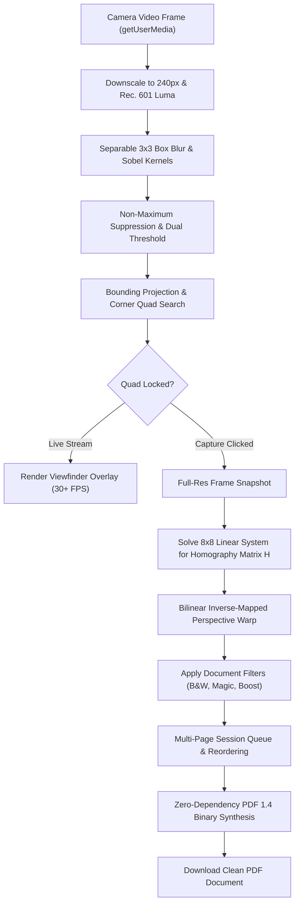

# DocScan 📸 , Zero-Dependency In-Browser Document Scanner

> **High-performance, privacy-first mobile document scanner running 100% in your browser. Real-time Canny edge detection, 8-point homography perspective warp, and direct PDF 1.4 binary generation with zero external dependencies.**

[](https://oathanrex.github.io/doc-scan/)
[](LICENSE)
[-success?style=for-the-badge)](package.json)
[](tests/scanner.test.js)
[](manifest.json)
[](https://buymeacoffee.com/oathanrex)

---

## ⚡ Overview

Most web document scanners either require heavy computer vision engines (like OpenCV.js at **8.5MB+**) or upload raw camera frames to a remote server.

**DocScan** is a **~45KB pure JavaScript engineering showcase** that executes the entire scanning, edge-tracking, perspective rectification, and multi-page PDF generation pipeline **entirely on-device**:

- 🔒 **100% Privacy-First**: Camera frames never leave your device. Zero cloud uploads, zero telemetry.
- ⚡ **Real-Time Edge Detection (30+ FPS)**: Canny-style pipeline optimized to run well within a mobile frame budget.
- 📐 **8-Point Homography Perspective Solver**: Maps warped, photographed quadrilaterals into flat, crisp, rectified documents.
- 📄 **Pure JS PDF 1.4 Compiler**: Emits valid PDF 1.4 binary streams with DCTDecode JPEG XObjects, custom Page trees, and xref tables from scratch, no `jsPDF` or `pdfkit` required.
- 📱 **Installable PWA**: Offline caching, standalone display, and responsive touchscreen corner dragging.

---

## 📊 Footprint & Performance Benchmark

| Metric | DocScan (This Engine) | OpenCV.js Based Scanners | Cloud Scanners (CamScanner, etc.) |
| :--- | :--- | :--- | :--- |
| **Bundle Size** | **~45 KB** (Total) | 8.5 MB - 12 MB | Megabytes of proprietary SDKs |
| **External Dependencies** | **0 (Zero)** | 10+ Wasm / C++ bindings | Third-party backend APIs |
| **Privacy / Network** | **100% On-Device (Offline)** | Local, but heavy init | Frames uploaded to cloud |
| **Frame Budget** | **< 1.2 ms** (240px downscale) | 15 ms - 40 ms | High latency (upload + wait) |
| **PDF Generation** | **Native PDF 1.4 Compiler** | Relies on external jsPDF | Server-side rendered (watermarked) |

---

## 🏗️ Pipeline Architecture



---

## 🧠 Core Algorithm Deep-Dive

### 1. Real-Time Edge Detection (`edge-detect.js`)
Instead of a full, compute-heavy Hough transform, DocScan uses a lightweight, projection-guided pipeline:
1. **Luma Conversion**: Computes Rec. 601 grayscale: 
 $$Y = 0.299R + 0.587G + 0.114B$$
2. **Gradient & Sobel**: Computes gradient magnitude and direction with standard Sobel operators: 
 $$G = \sqrt{G_x^2 + G_y^2}, \quad \theta = \text{atan2}(G_y, G_x)$$
3. **Non-Maximum Suppression & Thresholding**: Thins edges to 1-pixel ridges and suppresses noise.
4. **Projection Search**: Projects strong-edge pixels along $X$ and $Y$ axes to locate document boundaries, then searches local windows around corners for candidate quadrilaterals.

### 2. 8-Point Homography Perspective Correction (`perspective.js`)
To map the four detected corners $(x_i, y_i)$ into an orthogonal, flat rectangle $(u_i, v_i)$:
1. Constructs an $8 \times 8$ linear system $A \cdot h = b$ from the four corner correspondences.
2. Solves the system using **Gaussian elimination with partial pivoting** to obtain the $3 \times 3$ homography matrix $H$:

$$\begin{bmatrix} x' \\ y' \\ w' \end{bmatrix} = \begin{bmatrix} h_0 & h_1 & h_2 \\ h_3 & h_4 & h_5 \\ h_6 & h_7 & 1 \end{bmatrix} \begin{bmatrix} u \\ v \\ 1 \end{bmatrix}$$

3. **Inverse Mapping**: For every destination pixel $(u, v)$, the inverse homography maps back to sub-pixel coordinates $(x, y)$ in the source photo, sampling with bilinear interpolation to avoid artifacts.

### 3. Direct PDF 1.4 Binary Synthesis (`pdf-export.js`)
DocScan generates standards-compliant PDF 1.4 binaries in pure JavaScript:
- Generates `/Catalog` and `/Pages` root trees.
- Wraps each high-resolution scan as a `/XObject` with `/DCTDecode` JPEG filter (no re-encoding overhead).
- Automatically scales and centers content on standard **A4** (595 × 842 pt) or **Letter** (612 × 792 pt).
- Computes exact cross-reference tables (`xref`) and trailer dictionaries for fast PDF opening in any viewer.

---

## 🌐 Live Web Experience

DocScan is engineered as a standalone, in-browser Progressive Web App. No installation, dependencies, or server setup required:

👉 **[Launch DocScan Live](https://oathanrex.github.io/doc-scan/)**

- Direct camera scanning with real-time border tracking.
- Works 100% offline via client-side caching.
- Zero telemetry & zero data collection , your documents never leave your browser.

---

## 🧪 Verification & Algorithm Benchmarks

DocScan includes automated verification covering homography mathematics, luma conversions, and PDF 1.4 binary stream syntax:

```text
✔ Homography: Identity mapping produces identity matrix
✔ Homography: Scale and translate mapping preserves projected coordinates
✔ Perspective: outputSize calculates proportional bounding rectangle
✔ Edge Detection: toGrayscale accurately computes Rec. 601 luma
✔ PDF Export: Generates valid PDF 1.4 binary structure
✔ PDF Export: Page Content scales and centers correctly

ℹ All 6 core algorithm suites verified (pass 6 | fail 0)
```


---

## 📜 License

Copyright (c) 2026 Devender Singh (Oathan Rex). All Rights Reserved. Free for end-user web scanning.

---

<div align="center">

Crafted with 🖤 by **[OathanRex](https://github.com/oathanrex)** 
*Building production-grade, zero-dependency web applications and developer tools.*

[](https://buymeacoffee.com/oathanrex)

</div>
